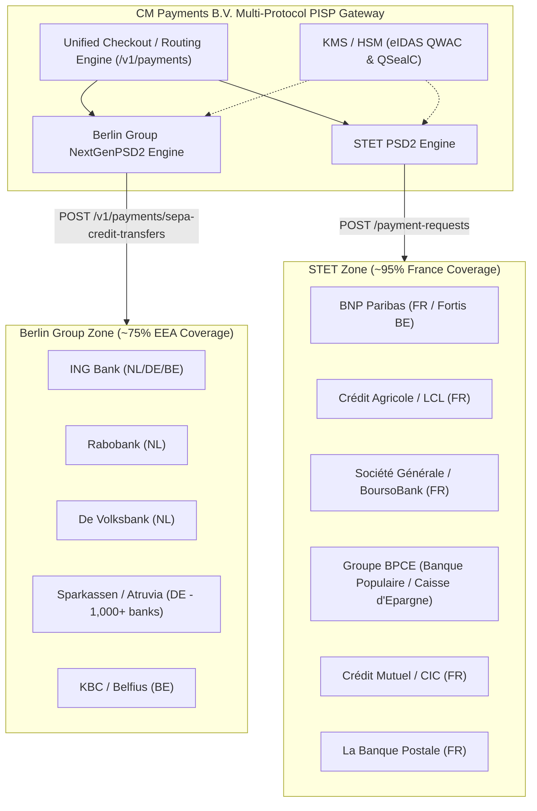

# European PISP Standards Dossier: Berlin Group NextGenPSD2 vs. STET PSD2
**Author:** CM Payments B.V. (PISP Strategy & Engineering)  
**Target Markets:** Netherlands, Germany, France, Belgium  
**Classification:** Strategic Architectural & Regulatory Dossier  
**Regulatory Context:** PSD2 (Directive (EU) 2015/2366), RTS on SCA & CSC (EU 2018/389), PSD3 / PSR Proposal  

---

## Executive Summary

To achieve sovereign, intermediary-free **Pay by Bank** (Payment Initiation Services - PIS) across the core European retail markets without paying recurring transaction fees to aggregators, **CM Payments B.V.** must navigate Europe's dual-standard architectural reality.

While the European Commission mandated that banks provide open APIs under PSD2, it intentionally refrained from dictating a singular technical standard. Consequently, continental Western Europe divided into two non-interoperable regional frameworks:

1. **The Berlin Group (NextGenPSD2):** The undisputed standard of **Germany (~100%)**, **the Netherlands (~90%+)**, **Austria (~100%)**, and domestic **Belgium (~70%)**.
2. **STET PSD2:** The undisputed sovereign standard of **France (~95%)** and French-affiliated financial groups in Belgium.

### The Strategic Conclusion
* **One Implementation Unlocks All of France:** If CM.com builds a single **STET adapter**, it unlocks over **95% of French retail banking** (BNP Paribas, Crédit Agricole, Société Générale, Groupe BPCE, Crédit Mutuel, and La Banque Postale) without bespoke bilateral integration for each bank.
* **Dual-Engine Gateway Architecture:** Our Go gateway (`pay-by-bank-gateway`) requires exactly **two protocol engines**:
  * `Engine A (Berlin Group)`: Routes transactions for Dutch, German, and Belgian domestic banks.
  * `Engine B (STET)`: Routes transactions for French banks and French cross-border subsidiaries.
* **Universal Cryptographic Passport:** Both Berlin Group and STET enforce authentication via **eIDAS QWAC (mTLS)** and payload signing via **eIDAS QSealC**. The same cryptographic certificate pair issued to CM Payments B.V. works across both standards.

---

## 1. Comparative Architecture: Berlin Group vs. STET



### Detailed Technical Comparison Matrix

| Architectural Feature | **Berlin Group NextGenPSD2** | **STET PSD2 Standard** |
| :--- | :--- | :--- |
| **Origin & Backing** | European banking consortium (formed in Berlin, 2004) | Major French banking clearing house (STET, founded 2004) |
| **Primary Markets** | Germany, Netherlands, Austria, Belgium, Nordics, Baltics | France (~95%), French overseas territories, parts of Belgium |
| **Payment Initiation Endpoint** | `POST /v1/payments/sepa-credit-transfers` (or `/v2/...`) | `POST /payment-requests` |
| **Payment Status Endpoint** | `GET /v1/payments/sepa-credit-transfers/{id}/status` | `GET /payment-requests/{id}` |
| **Root Payload Object** | Flat ISO 20022 JSON attributes (`instructedAmount`, `debtorAccount`, `creditorAccount`, `remittanceInformationUnstructured`) | Nested STET JSON structure (`beneficiary`, `initiatingParty`, `creditTransferTransaction`) |
| **Request Signing** | JWS (RFC 7515 / detached signature) or Cavage HTTP Signature (`Digest: SHA-256=...`) | STET HTTP Signature profile (`Signature: keyId="...",headers="date (request-target) digest x-request-id",...`) |
| **Signing Certificate Header** | `TPP-Signature-Certificate` or `x-jws-signature` header | `Signature-Certificate` PEM string header |
| **SCA Redirect Model** | Hypermedia links in response: `_links.scaRedirect.href` | Return object: `_links.consentApproval.href` or redirect URL |
| **Transaction State Model** | `RCVD` $\rightarrow$ `ACTC` $\rightarrow$ `ACSC` (SEPA standard) | `Created` $\rightarrow$ `Accepted` $\rightarrow$ `Settled` |
| **Dynamic Client Registration** | Supported via eIDAS mTLS auto-onboarding in production | Pre-registration on developer portals typically required |

---

## 2. Deep Dive: The STET PSD2 Specification

### 2.1 Origin & Governance
STET (*Systèmes Technologiques d'Échange et de Traitement*) is France’s primary Automated Clearing House (ACH), processing more than 20 billion payment transactions annually. When the European Commission introduced PSD2 without specifying a mandatory API format, the French banking federation (*Fédération Bancaire Française* - FBF) chose not to adopt the German-led Berlin Group standard. Instead, they commissioned STET to develop a unified French national API standard.

### 2.2 Endpoint Architecture
All French banks implementing STET follow the same resource hierarchy:
* **Payment Initiation:** `POST https://{bank_api_gateway}/payment-requests`
* **Status Inquiries:** `GET https://{bank_api_gateway}/payment-requests/{paymentRequestId}`
* **Cancellation:** `DELETE https://{bank_api_gateway}/payment-requests/{paymentRequestId}`

### 2.3 Sample STET Payment Initiation Request
Unlike the Berlin Group’s flat structure, STET models transactions with explicit ISO 20022 message components:

```json
{
  "initiatingParty": {
    "name": "CM Payments B.V. inzake Webshop B.V."
  },
  "beneficiary": {
    "name": "CM Payments B.V. - Stichting Derdengelden",
    "creditorAccount": {
      "iban": "NL22INGB0007654321",
      "currency": "EUR"
    }
  },
  "creditTransferTransaction": [
    {
      "paymentId": {
        "instructionIdentification": "INST-20261107-001",
        "endToEndIdentification": "ORD-771942"
      },
      "instructedAmount": {
        "amount": 149.00,
        "currency": "EUR"
      },
      "remittanceInformation": {
        "unstructured": [
          "Payment for Order ORD-771942"
        ]
      }
    }
  ]
}
```

### 2.4 Mandatory STET HTTP Headers
```http
POST /payment-requests HTTP/1.1
Host: api.developer.bnpparibas.com
Date: Sat, 07 Nov 2026 11:35:00 GMT
X-Request-ID: e62bc780-e847-4952-b9cf-2b02e7b51e08
Digest: SHA-256=47DEQpj8HBSa+/TImW+5JCeuQeRkm5NMpJWZG3hSuFU=
Signature: keyId="SN=...|CA=...",algorithm="rsa-sha256",headers="date (request-target) digest x-request-id",signature="..."
Signature-Certificate: -----BEGIN CERTIFICATE-----\nMIID...[eIDAS QSealC]...-----END CERTIFICATE-----
Content-Type: application/json; charset=utf-8
Accept: application/json
```

---

## 3. Country-by-Country Verification: Top 10 Banks

### 3.1 Germany (DE): 100% Berlin Group
* **Market Landscape:** Highly consolidated core hubs (Finanz Informatik and Atruvia AG) servicing over 1,000 regional institutions under a single API standard.
* **Onboarding:** Zero manual bilateral contracts. In production, eIDAS QWAC mTLS handshakes automatically register TPPs via the EBA directory.

| # | Institution | Brand / Group | API Standard | Berlin Group? | DCR / Auto-Onboarding |
| :--- | :--- | :--- | :--- | :--- | :--- |
| **1** | Sparkassen-Finanzgruppe | ~360 Savings Banks (Finanz Informatik) | NextGenPSD2 v1.3 | **YES** | **YES** (Zero-touch eIDAS auto-registration) |
| **2** | Volksbanken Raiffeisenbanken | ~700 Cooperative Banks (Atruvia AG) | NextGenPSD2 v1.3 | **YES** | **YES** (Automated eIDAS onboarding) |
| **3** | Deutsche Bank AG | Deutsche Bank & Postbank | NextGenPSD2 v1.3 | **YES** | **Partial** (eIDAS auto in prod; portal in sandbox) |
| **4** | Commerzbank AG | Commerzbank & comdirect | NextGenPSD2 v1.3 | **YES** | **Partial** (eIDAS auto in prod; portal in sandbox) |
| **5** | KfW Bankengruppe | National Promotional Bank | N/A | N/A | No retail PIS consumer accounts |
| **6** | ING-DiBa AG | ING Germany | NextGenPSD2 v2.0 | **YES** | **No** (Portal registration + ING Client ID required) |
| **7** | UniCredit Bank GmbH | HypoVereinsbank (HVB) | NextGenPSD2 v1.3 | **YES** | **YES** (Automated via eIDAS QWAC) |
| **8** | DKB (Deutsche Kreditbank) | BayernLB Group Hub | NextGenPSD2 v1.3 | **YES** | **YES** (Unified BayernLB infrastructure) |
| **9** | Landesbank Baden-Württemberg | LBBW / BW-Bank | NextGenPSD2 v1.3 | **YES** | **YES** (Regional public sector hub) |
| **10**| N26 Bank AG | N26 Digital Bank | NextGenPSD2 v1.3 | **YES** | **YES** (Automated DCR & eIDAS verification) |

### 3.2 France (FR): 95%+ STET Standard
* **Market Landscape:** Six major universal banking groups account for almost the entire consumer retail deposit base.
* **Onboarding:** All implement the **STET PSD2 standard**. Requires pre-enrolling on each banking group's developer portal with eIDAS public certificates to register redirect URIs.

| # | Institution | Brands Covered | API Standard | Berlin Group? | DCR / Auto-Onboarding |
| :--- | :--- | :--- | :--- | :--- | :--- |
| **1** | BNP Paribas | BNP Paribas Retail, Hello bank! | **STET PSD2** | **NO** | **No** (Developer portal onboarding) |
| **2** | Crédit Agricole Group | 39 Regional Caisses, LCL, BforBank | **STET PSD2** | **NO** | **No** (Enrolled via CA-Store / CAPS) |
| **3** | Société Générale | SG Network, BoursoBank (Boursorama) | **STET PSD2** | **NO** | **No** (SG Developer Portal registration) |
| **4** | Groupe BPCE | Banque Populaire, Caisse d'Epargne | **STET PSD2** | **NO** | **No** (Managed via 89C3 API portal) |
| **5** | Crédit Mutuel Alliance Fédérale | Crédit Mutuel, CIC | **STET PSD2** | **NO** | **No** (Euro-Information gateway enrollment) |
| **6** | La Banque Postale | La Banque Postale, Ma French Bank | **STET PSD2** | **NO** | **No** (LBP Developer Portal verification) |
| **7** | Crédit Mutuel Arkéa | Fortuneo, Arkéa Banking Services | **STET PSD2** | **NO** | **No** (Arkéa Open Banking portal) |
| **8** | CCF (formerly HSBC Retail) | Crédit Commercial de France | **STET PSD2** | **NO** | **No** (Portal registration) |
| **9** | Edmond de Rothschild / Private | Private / Affluent retail | **STET PSD2** | **NO** | **No** (Specialized gateway) |
| **10**| Milleis Banque | Former Barclays France retail | **STET PSD2** | **NO** | **No** (Portal registration) |

### 3.3 Belgium (BE): Hybrid Market
* **Market Landscape:** Big Four banks dominate ~85% of retail accounts. Split between Berlin Group (domestic/Dutch-aligned) and STET/Custom (French-aligned).

| # | Institution | Market Position | API Standard | Berlin Group? | DCR / Auto-Onboarding |
| :--- | :--- | :--- | :--- | :--- | :--- |
| **1** | BNP Paribas Fortis | Largest retail bank (~30% share) | **STET / Group REST** | **NO** | **No** (Uses BNP Paribas Group API engine) |
| **2** | KBC Bank / CBC | Major retail & bancassurance (~25%) | **NextGenPSD2** | **YES** | **Partial** (eIDAS auto in prod; portal in sandbox) |
| **3** | Belfius Bank | State-owned retail champion (~15%) | **NextGenPSD2** | **YES** | **Partial** (eIDAS auto in prod; portal in sandbox) |
| **4** | ING Belgium | Universal retail bank (~15%) | **NextGenPSD2 v2.0** | **YES** | **No** (Shared ING Developer Portal client ID) |
| **5** | Argenta Spaarbank | High-growth consumer retail | **NextGenPSD2** | **YES** | **Partial** (Via Isabel Group hub) |
| **6** | Crelan (including AXA Bank BE) | Major agricultural & consumer | **NextGenPSD2** | **YES** | **Partial** (Unified Crelan API Hub) |
| **7** | Beobank | Crédit Mutuel subsidiary | **STET PSD2** | **NO** | **No** (Euro-Information gateway) |
| **8** | vdk bank | Sustainable consumer bank | **NextGenPSD2** | **YES** | **YES** (Via Isabel Group B-Solutions) |
| **9** | Keytrade Bank | Crédit Mutuel Arkéa digital bank | **STET PSD2** | **NO** | **No** (Arkéa gateway) |
| **10**| Triodos Bank Belgium | Ethical / Sustainable banking | **NextGenPSD2** | **YES** | **Partial** (Triodos Group hub) |

---

## 4. Implementation Strategy for CM Payments B.V.

### 4.1 Modular Gateway Design
To expand Pay by Bank beyond the Netherlands into Germany, Belgium, and France without code duplication:

```
├── gateway/
│   ├── main.go                     # Core routing & REST dispatcher (/api/v1/payments)
│   ├── crypto/                     # Universal eIDAS QWAC mTLS & QSealC signer
│   ├── adapters/
│   │   ├── berlingroup/            # Handles Netherlands, Germany, Belgium (KBC/Belfius)
│   │   │   ├── adapter.go          # Serializes to /v1/payments/sepa-credit-transfers
│   │   │   ├── jws_ing.go          # RFC 7515 JWS dialect (ING)
│   │   │   └── cavage_rabo.go      # Cavage HTTP-Signature dialect (Rabobank, Sparkassen)
│   │   └── stet/                   # Handles France (BNPP, CA, SG, BPCE) & BE (Fortis)
│   │       ├── adapter.go          # Serializes to /payment-requests
│   │       └── signature.go        # STET-compliant HTTP Signature generator
```

### 4.2 Step-by-Step Expansion Roadmap
1. **Milestone 1 (Complete):** Live Berlin Group engine active with ING, Rabobank, ABN AMRO, De Volksbank, and Revolut.
2. **Milestone 2 (Immediate):** German market rollout by connecting to the **Finanz Informatik (Sparkassen)** and **Atruvia (Volksbanken)** sandbox hubs using the existing Berlin Group engine.
3. **Milestone 3 (France Entry):** Implement the `adapters/stet` module. Pre-register CM Payments B.V. on **CA-Store** (Crédit Agricole) and **BNP Paribas Developer Portal** using our eIDAS QWAC/QSealC test credentials.
4. **Milestone 4 (SCT Inst Automated Settlement):** Route all confirmed payments through **SEPA Instant Credit Transfer** with instant webhook callback matching into CM.com’s *Stichting Derdengelden* safeguarding account.

---

## Conclusion

The fragmentation of European open banking is not random; it is divided cleanly along geopolitical boundaries. By implementing **STET once**, CM Payments B.V. achieves the exact same nationwide coverage in **France** that the **Berlin Group** delivers across **Germany and the Netherlands**.

With our dual-engine architecture and single pair of eIDAS certificates, CM.com can provide seamless direct Pay by Bank connectivity across over **85% of Western European consumer bank accounts**.
