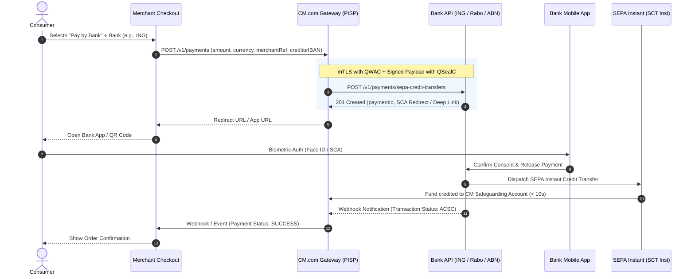

# Direct PISP Architecture: Dutch Top 3 Banks (ING, Rabobank, ABN AMRO)
**Company:** CM.com (CM Payments B.V.)  
**Role:** Payment Service Provider / PISP (pending DNB Service 7 scope extension)  
**Target Coverage:** ~85%–90% of Dutch Consumer Retail Banking  

---

## 1. Regulatory & Cryptographic Prerequisites

To establish direct mTLS connections and execute Payment Initiation (PIS) calls with ING, Rabobank, and ABN AMRO without an intermediary:

1. **Regulatory License & Passporting:**
   * Regulated under **CM Payments B.V.**'s PSD2 Payment Institution (PI) license registered with **De Nederlandsche Bank (DNB)**.
   * Explicit authorization for **Payment Initiation Services (PISP)** (PSD2 Annex I, Service 7). **Not yet held by CM Payments B.V.**; requires a DNB scope extension (see `psd2_pisp_regulatory_analysis.md`).
2. **eIDAS Cryptographic Certificates (from a Qualified Trust Service Provider - QTSP):**
   * **QWAC (Qualified Website Authentication Certificate):** Used for mutual TLS (mTLS) handshakes to authenticate CM.com servers to bank API gateways.
   * **QSealC (Qualified Electronic Seal Certificate):** Used for HTTP request payload signing (JWS / RFC 7515 or Berlin Group HTTP Signature specifications) to guarantee non-repudiation and integrity.
3. **API Standard Alignment:**
   * Dutch banks primarily implement the **Berlin Group NextGenPSD2** specification with minor bank-specific dialect variations.

---

## 2. Bank Developer Portals & API Specs

| Bank | Developer Portal | Specification Standard | Authentication & Consent |
| :--- | :--- | :--- | :--- |
| **ING** | [ING Developer](https://developer.ing.com) | Berlin Group / REST JSON | OAuth2 mTLS + App-to-App deep link |
| **Rabobank** | [Rabobank Developer](https://developer.rabobank.nl) | NextGenPSD2 & Premium APIs | mTLS + Rabobank App authentication |
| **ABN AMRO** | [ABN AMRO Developer](https://developer.abnamro.com) | NextGenPSD2 PIS API | mTLS + ABN AMRO App QR / Deep link |

---

## 3. End-to-End Direct PISP Flow

---

## 4. Collection & Settlement Options for CM.com

### Option A: Omnibus Collection (Stichting Derdengelden / Safeguarding Account) — **Recommended**
* **Flow:** Consumer funds land directly in CM.com’s dedicated third-party funds account (*Stichting Derdengelden* / DNB safeguarding account).
* **Benefits:**
  * Unified reconciliation and payout schedules across all merchants.
  * Native fee deduction (merchant processing fees deducted prior to payout).
  * Automated instant refunds back to consumer IBAN via outgoing SCT Inst.
  * Consistent transaction reference matching.

### Option B: Direct-to-Merchant IBAN
* **Flow:** The creditor account in the PIS initiation is the merchant’s own IBAN.
* **Benefits:** Zero float or escrow handling needed by CM.com.
* **Drawbacks:** CM.com cannot guarantee automated instant refunds, fee reconciliation becomes split-billing, and payment confirmation depends entirely on bank push notifications rather than account statement matching.

---

## 5. Implementation Roadmap for CM.com Engineering

1. **Certificate Management Service:** Implement automated key rotation and storage for QWAC and QSealC in KMS / HSM.
2. **Bank Connector Microservices:**
   * Build modular connectors conforming to Berlin Group NextGenPSD2 schema with dialect adapters for ING, Rabobank, and ABN AMRO.
3. **App-to-App UX Engine:** Implement universal link routing so mobile shoppers launch their banking app directly with zero web drop-off.
4. **Instant Reconciliation Worker:** Integrate CAMT.053 / CAMT.054 real-time XML processing and bank status webhooks for immediate order fulfillment.
