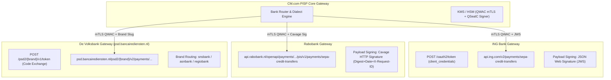

# Dutch Banks Direct PISP API Analysis: ING, Rabobank & De Volksbank
**Target Entity:** CM.com (CM Payments B.V. – Licensed PSD2 PISP under De Nederlandsche Bank)  
**Scope:** Direct Payment Initiation Service (PIS) API Endpoints, Security & Authentication Architecture  
**Banks Analyzed:**
1. **ING Bank N.V.** (ING Developer Portal)
2. **Coöperatieve Rabobank U.A.** (Rabobank Developer Portal)
3. **De Volksbank N.V.** (Unified Gateway for SNS Bank, ASN Bank, and RegioBank)

---

## 1. Executive Summary & Ecosystem Context

In the Netherlands, retail banking is heavily consolidated. Three major banking entities—**ING Bank**, **Rabobank**, and **De Volksbank** (alongside ABN AMRO)—account for the vast majority of consumer transaction accounts.

To establish direct, intermediary-free Payment Initiation Services (PIS) under the PSD2 Regulatory Technical Standards (RTS) and Berlin Group NextGenPSD2 frameworks:
* **Regulatory Prerequisites:** CM Payments B.V. is a DNB-registered Payment Institution authorized for Services 3 and 5 only. Payment Initiation Services (Annex I, Service 7) require a scope extension that has **not yet been granted** (see `psd2_pisp_regulatory_analysis.md`).
* **Cryptographic Credentials:** Qualified Trust Service Provider (QTSP) certificates:
  * **eIDAS QWAC (Qualified Website Authentication Certificate):** Mutual TLS (mTLS) client authentication at the network transport layer.
  * **eIDAS QSealC (Qualified Electronic Seal Certificate):** Application-layer digital signing of HTTP request bodies and headers to guarantee non-repudiation and integrity.
* **SCA Model in the Netherlands:** All Dutch banks strictly enforce the **Redirect SCA model** (often enhanced via App-to-App Universal Links). Dutch regulators and the Dutch Banking Association (*Nederlandse Vereniging van Banken* - NVB) prohibit Embedded SCA (where Third Party Providers collect online banking passwords or OTPs).

---

## 2. Comparative Matrix: PIS Specifications

| Feature / Attribute | **ING Bank** | **Rabobank** | **De Volksbank** (SNS, ASN, RegioBank) |
| :--- | :--- | :--- | :--- |
| **Developer Portal** | [developer.ing.com](https://developer.ing.com) | [developer.rabobank.nl](https://developer.rabobank.nl) | [openbanking.devolksbank.nl](https://openbanking.devolksbank.nl) |
| **Standard Followed** | Berlin Group NextGenPSD2 + ING REST | Berlin Group NextGenPSD2 (v1.3.x) | Berlin Group NextGenPSD2 (v1.3.x / v2 paths) |
| **Sandbox Base URL** | `https://api.sandbox.ing.com` | `https://api-sandbox.rabobank.nl/openapi/sandbox` | `https://psd.bancairediensten.nl/psd2/{brand}/sandbox` |
| **Production Base URL** | `https://api.ing.com` | `https://api.rabobank.nl` | `https://psd.bancairediensten.nl/psd2/{brand}` |
| **Supported Brands** | ING Netherlands (and EU branches) | Rabobank | `snsbank`, `asnbank`, `regiobank` |
| **Payment Initiation Path** | `POST /v2/payments/sepa-credit-transfers` *(migrating from v1)* | `POST /openapi/payments/payment-initiation/pis/v1/payments/sepa-credit-transfers` | `POST /psd2/{brand}/v2/payments/sepa-credit-transfers` |
| **Payment Status Path** | `GET /v2/payments/sepa-credit-transfers/{paymentId}/status` | `GET /openapi/payments/payment-initiation/pis/v1/payments/sepa-credit-transfers/{paymentId}/status` | `GET /psd2/{brand}/v2/payments/sepa-credit-transfers/{paymentId}/status` |
| **Payment Details Path** | `GET /v2/payments/sepa-credit-transfers/{paymentId}` | `GET /openapi/payments/payment-initiation/pis/v1/payments/sepa-credit-transfers/{paymentId}` | `GET /psd2/{brand}/v2/payments/sepa-credit-transfers/{paymentId}` |
| **Payment Cancellation Path** | `DELETE /v2/payments/sepa-credit-transfers/{paymentId}` | `DELETE /openapi/payments/payment-initiation/pis/v1/payments/sepa-credit-transfers/{paymentId}` | `DELETE /psd2/{brand}/v2/payments/sepa-credit-transfers/{paymentId}` |
| **Authentication & Tokens** | OAuth 2.0 `client_credentials` over mTLS | OAuth 2.0 / eIDAS direct mTLS validation | OAuth 2.0 Authorize + Token exchange |
| **Transport Layer Security** | mTLS with eIDAS QWAC | mTLS with eIDAS QWAC | mTLS with eIDAS QWAC |
| **Payload Signing** | **JSON Web Signature (JWS)** *(Cavage HTTP-Sig sunsetting March 2027)* | **Cavage HTTP Signatures** (`Digest` + `Signature` + `Signature-Certificate`) | **eIDAS QSealC Signatures** (`Digest` + `Signature` / Certificate header) |
| **SCA Flow** | Redirect + Universal Links into ING App | Redirect + Universal Links into Rabo App | Redirect + Universal Links to brand apps |
| **Direct Settlement Rail** | SEPA Instant Credit Transfer (SCT Inst) | SEPA Instant Credit Transfer (SCT Inst) | SEPA Instant Credit Transfer (SCT Inst) |

---

## 3. Deep-Dive: ING Bank (ING Developer Portal)

### 3.1 Overview & Architecture
ING provides access to its Payment Initiation Service (PIS) APIs through the **ING Developer Portal**. While aligning with the Berlin Group NextGenPSD2 guidelines, ING incorporates specific architectural layers for client authentication, token generation, and signature verification.

### 3.2 Environments & Base URLs
* **Sandbox Environment:** `https://api.sandbox.ing.com`
* **Production Environment:** `https://api.ing.com`

### 3.3 Security & Authentication
1. **Mutual TLS (mTLS):**
   * Both Sandbox and Production require client-side TLS certificates.
   * Production strictly requires an **eIDAS QWAC** issued by an accredited QTSP.
2. **OAuth 2.0 Token Generation:**
   * **Endpoint:** `POST /oauth2/token`
   * **Grant Type:** `grant_type=client_credentials`
   * **Payload Format:** `application/x-www-form-urlencoded`
   * **Request Parameters:**
     * `grant_type`: `client_credentials`
     * `client_id`: Pre-registered Application Client ID from ING Portal
     * `scope`: PSD2 PIS scope permissions
   * **Token Lifetime:** Typically **900 seconds (15 minutes)**. Applications must cache tokens and renew upon expiration rather than requesting on every call.
3. **Application Layer Signing (Crucial Transition: HTTP-Signature to JWS):**
   * **Legacy:** Cavage HTTP Signatures (`Digest: SHA-256=...` and `Authorization: Signature keyId="...",algorithm="rsa-sha256",headers="(request-target) date digest x-request-id",signature="..."`).
   * **Current Mandatory Standard (NextGen JWS):** ING mandates migration to **JSON Web Signature (JWS)** per RFC 7515 / Open Banking Europe specifications on `v2` endpoints. HTTP-signed tokens are scheduled for complete deprecation by **March 1, 2027**.
   * JWS headers include:
     * `x-jws-signature`: Detached JWS signature created using the private key associated with the TPP's eIDAS QSealC.
     * `Digest`: Cryptographic hash (`SHA-256` or `SHA-512`) of the request payload.

### 3.4 API Endpoints Specification
* **Initiate Payment (SEPA Credit Transfer):**
  * `POST /v2/payments/sepa-credit-transfers`
  * (Batch / XML Alternative: `POST /v2/payments/pain.001-sepa-credit-transfers`)
* **Get Payment Status:**
  * `GET /v2/payments/sepa-credit-transfers/{paymentId}/status`
* **Get Payment Resource Details:**
  * `GET /v2/payments/sepa-credit-transfers/{paymentId}`
* **Cancel / Delete Payment:**
  * `DELETE /v2/payments/sepa-credit-transfers/{paymentId}`

### 3.5 Mandatory Request Headers (Initiation)
```http
POST /v2/payments/sepa-credit-transfers HTTP/1.1
Host: api.ing.com
Authorization: Bearer <access_token>
X-Request-ID: b48e1a5f-7f89-4b6e-8ff5-15a31b671e21
Date: Sat, 07 Nov 2026 08:30:00 GMT
Digest: SHA-256=47DEQpj8HBSa+/TImW+5JCeuQeRkm5NMpJWZG3hSuFU=
x-jws-signature: eyJhbGciOiJSUzI1NiIsImI2NCI6ZmFsc2UsImNyaXQiOlsiYjY0Il19...
PSU-IP-Address: 82.169.45.12
PSU-User-Agent: Mozilla/5.0 (iPhone; CPU iPhone OS 17_4 like Mac OS X)...
TPP-Redirect-URI: https://pay.cm.com/redirect/callback
TPP-Nok-Redirect-URI: https://pay.cm.com/redirect/cancel
Content-Type: application/json
```

### 3.6 Sample Request Body
```json
{
  "instructedAmount": {
    "currency": "EUR",
    "amount": "49.95"
  },
  "debtorAccount": {
    "iban": "NL91INGB0001234567"
  },
  "creditorName": "CM Payments B.V. - Stichting Derdengelden",
  "creditorAccount": {
    "iban": "NL22INGB0007654321"
  },
  "remittanceInformationUnstructured": "Order CM-987654"
}
```

### 3.7 SCA & App-to-App Flow
* **Response:** Successful initiation returns `HTTP 201 Created` with a `paymentId`, `transactionStatus: "RCVD"`, and hypermedia link:
  ```json
  "_links": {
    "scaRedirect": {
      "href": "https://myaccount.ing.com/consent/authorize?paymentId=..."
    },
    "status": {
      "href": "/v2/payments/sepa-credit-transfers/b48e1a5f.../status"
    }
  }
  ```
* **App-to-App Redirection:**
  * The `scaRedirect.href` URL is an Apple iOS Universal Link / Android App Link registered by ING.
  * When invoked from mobile safari/chrome or CM.com's web checkout, the device seamlessly opens the **ING Mobiel Bankieren App**.
  * The user authorizes the transfer using biometric FaceID / TouchID.
  * **Strict Restriction:** ING explicitly forbids rendering the SCA page in an `<iframe>` or embedded webview. Violation causes security lockout.
* **Unfinalised Payments Expiration:** Uncompleted payment attempts remain in pending state for **10 days** before being purged by ING.

---

## 4. Deep-Dive: Rabobank (Rabobank Developer Portal)

### 4.1 Overview & Architecture
Rabobank implements the **Berlin Group NextGenPSD2 (v1.3.x)** specification under its Open Banking suite on the Rabobank Developer Portal. The integration paths are standardized, structured under the `/openapi/` gateway path.

### 4.2 Environments & Base URLs
* **Sandbox Environment:** 
  `https://api-sandbox.rabobank.nl/openapi/sandbox`  
  *(Alternative Sandbox Gateway: `https://api.rabobank.nl/openapi/sandbox/payments/payment-initiation`)*
* **Production Environment:** 
  `https://api.rabobank.nl`

### 4.3 Security & Authentication
1. **Mutual TLS (mTLS):**
   * High-assurance mTLS handshake using the TPP's **eIDAS QWAC**.
2. **eIDAS Request Signing (Cavage HTTP Signature Draft):**
   * Rabobank strictly verifies digital signatures on all state-changing PIS calls using the TPP's **eIDAS QSealC**.
   * **Required Signing Components:**
     * `Digest`: Base64-encoded `SHA-256` or `SHA-512` hash of the HTTP body (e.g., `SHA-256=...`).
     * `Date`: RFC 1123 HTTP format date.
     * `X-Request-ID`: Client-generated UUID tracking the request.
     * `PSU-IP-Address`: End-consumer's public IPv4/IPv6 address.
     * `Signature`: Constructed string signed using the private key corresponding to the QSealC:
       ```text
       keyId="SN=...|CA=...",algorithm="rsa-sha256",headers="date x-request-id digest psu-ip-address",signature="..."
       ```
     * `Signature-Certificate` / `TPP-Signature-Certificate`: Public certificate chain in PEM format.

### 4.4 API Endpoints Specification
* **Initiate Payment (Single SEPA Credit Transfer):**
  * `POST /openapi/payments/payment-initiation/pis/v1/payments/sepa-credit-transfers`
* **Get Payment Status:**
  * `GET /openapi/payments/payment-initiation/pis/v1/payments/sepa-credit-transfers/{payment-id}/status`
* **Get Payment Details:**
  * `GET /openapi/payments/payment-initiation/pis/v1/payments/sepa-credit-transfers/{payment-id}`
* **Cancel / Delete Payment Order:**
  * `DELETE /openapi/payments/payment-initiation/pis/v1/payments/sepa-credit-transfers/{payment-id}`

### 4.5 Mandatory Request Headers (Initiation)
```http
POST /openapi/payments/payment-initiation/pis/v1/payments/sepa-credit-transfers HTTP/1.1
Host: api.rabobank.nl
X-Request-ID: c57d291e-45e1-4cfa-a4a3-7649514ef101
Date: Sat, 07 Nov 2026 08:30:00 GMT
PSU-IP-Address: 194.109.12.34
PSU-User-Agent: Mozilla/5.0 (Windows NT 10.0; Win64; x64)...
TPP-Redirect-URI: https://pay.cm.com/redirect/rabobank/callback
TPP-Nok-Redirect-URI: https://pay.cm.com/redirect/rabobank/cancel
Digest: SHA-256=7+3d...
Signature: keyId="...",algorithm="rsa-sha256",headers="date x-request-id digest psu-ip-address",signature="..."
TPP-Signature-Certificate: MIIFazCCA1OgAwIBAgIU...
Content-Type: application/json
Accept: application/json
```

### 4.6 SCA, App-to-App & ISO 20022 Status Lifecycle
* **Response Payload (`201 Created`):**
  ```json
  {
    "transactionStatus": "RCVD",
    "paymentId": "rabo-pis-9876543210",
    "_links": {
      "scaRedirect": {
        "href": "https://bankieren.rabobank.nl/oauth2/authorize?..."
      },
      "status": {
        "href": "/openapi/payments/payment-initiation/pis/v1/payments/sepa-credit-transfers/rabo-pis-9876543210/status"
      }
    }
  }
  ```
* **Authentication Journey:**
  * **Mobile:** The `scaRedirect.href` routes through Rabobank's universal links into the **Rabo App**. Customer completes biometric authentication.
  * **Desktop Web:** Directs to Rabobank Online Banking, presenting a dynamic color-code / QR code to be scanned with the customer's **Rabo App** or hardware **Rabo Scanner**.
* **Status Progression (ISO 20022):**
  1. `RCVD` (Received / Order created)
  2. `ACTC` (Accepted Technical Validation)
  3. `PATC` (Partially Authenticated) -> `ACSP` (Accepted Settlement in Process)
  4. `ACSC` (Accepted Credit Settlement Completed) — For SEPA Instant transfers, settlement completes within seconds across RT1/TIPS rails.

---

## 5. Deep-Dive: De Volksbank (SNS Bank, ASN Bank, RegioBank)

### 5.1 Architecture & Single-License Structure
De Volksbank N.V. is unique among the top Dutch banks: it operates three prominent consumer retail brands—**SNS Bank**, **ASN Bank**, and **RegioBank**—under a **single unified banking license and shared IT infrastructure**.
* **Unified Developer Portal:** [openbanking.devolksbank.nl](https://openbanking.devolksbank.nl)
* **API Gateway Host:** `psd.bancairediensten.nl`
* **Brand Routing Strategy:** Rather than maintaining separate hosts, De Volksbank uses path-based brand multiplexing:
  * Brand slug `{brand}` $\in$ `["snsbank", "asnbank", "regiobank"]`

### 5.2 Environments & Base URLs
* **Sandbox Environment:** 
  `https://psd.bancairediensten.nl/psd2/{brand}/sandbox`
* **Production Environment:** 
  `https://psd.bancairediensten.nl/psd2/{brand}`

### 5.3 OAuth 2.0 & Token Exchange Architecture
De Volksbank utilizes an explicit OAuth 2.0 flow with Berlin Group NextGenPSD2 endpoints:
* **Authorize Endpoint:** 
  `GET /psd2/{brand}/v1/authorize`  
  *(Redirects customer to the brand's online banking environment for authorization)*
* **Token Endpoint:** 
  `POST /psd2/{brand}/v1/token`  
  * Used to exchange the authorization code for an OAuth2 Bearer Access Token.
  * **Strict Validation Quirk:** The `redirect_uri` supplied in the token redemption request must match the pre-registered URI character-for-character; **wildcards are strictly rejected**.

### 5.4 API Endpoints Specification (Berlin Group v2 Paths)
* **Initiate Payment (SEPA Credit Transfer):**
  * `POST /psd2/{brand}/v2/payments/sepa-credit-transfers`
* **Get Payment Status:**
  * `GET /psd2/{brand}/v2/payments/sepa-credit-transfers/{payment-id}/status`
* **Get Payment Resource Details:**
  * `GET /psd2/{brand}/v2/payments/sepa-credit-transfers/{payment-id}`
* **Cancel Payment:**
  * `DELETE /psd2/{brand}/v2/payments/sepa-credit-transfers/{payment-id}`
  *(Also supports `DELETE .../v2/deferred-payments/...` for agended transfers)*

### 5.5 Mandatory Request Headers (Initiation)
```http
POST /psd2/snsbank/v2/payments/sepa-credit-transfers HTTP/1.1
Host: psd.bancairediensten.nl
Authorization: Bearer <access_token>
X-Request-ID: 7a82fb41-d602-4c28-984e-83679234aa6b
Psu-Ip-Address: 84.241.198.50
Tpp-Redirect-Uri: https://pay.cm.com/redirect/sns/callback
Tpp-Nok-Redirect-Uri: https://pay.cm.com/redirect/sns/cancel
Digest: SHA-256=...
Signature: keyId="...",algorithm="rsa-sha256",...
Content-Type: application/json
Accept: application/json
```

### 5.6 SCA, App-to-App & Bank-Specific Quirks
* **Brand-Specific Authentication Portals:**
  * When `scaRedirect` is returned:
    * SNS Bank users land at `https://mijn.snsbank.nl/...`
    * ASN Bank users land at `https://zelfregelen.asnbank.nl/...`
    * RegioBank users land at `https://mijn.regiobank.nl/...`
* **Mobile Banking Apps:** Each brand maintains its own independent mobile app:
  * **SNS Mobiel Bankieren**
  * **ASN Bankieren**
  * **RegioBank App**
  Universal links route customers directly into their respective brand app for biometric approval.
* **Critical Time Window Quirk:** De Volksbank enforces a strict initiation window: once the PSU authorizes the payment session, the first PIS payment submission must execute within **10 minutes**; otherwise, authorization expires.
* **Character Encoding:** Payload remittance information strictly requires standard European Payments Council (EPC) UTF-8 Latin subset; unsupported accented characters trigger an immediate validation rejection.

---

## 6. Synthesis: Technical Quirks & Architectural Differences



### Key Dialect & Implementation Differences

| Dimension | ING Bank | Rabobank | De Volksbank (SNS, ASN, Regio) |
| :--- | :--- | :--- | :--- |
| **API Path Versioning** | Migrating to `v2` (`v2/payments/...`) | Standard `pis/v1` | Explicit `v2` (`psd2/{brand}/v2/...`) |
| **Message Signing** | **RFC 7515 JWS** (Mandatory modern standard) | **Cavage HTTP Signatures** (`Signature` header) | **Berlin Group HTTP Signatures** with QSealC |
| **Domain Architecture** | Dedicated host (`api.ing.com`) | Dedicated host (`api.rabobank.nl`) | Shared multi-brand host (`psd.bancairediensten.nl`) |
| **Client Token Scope** | Application token (client_credentials) | Direct certificate-bound mTLS / API Key | OAuth 2.0 authorization code / token |
| **Desktop Web SCA** | Browser login or ING App QR scan | Rabo Scanner or Rabo App Color Code | Brand online banking or Digipas/App QR |
| **Cancellation Realities** | Deletable in pending state; irrevocable post-SCA | Deletable in pending state; irrevocable post-SCA | Deletable in pending state; irrevocable post-SCA |

---

## 7. Recommended Implementation Architecture for CM.com

1. **Connector Adapter Pattern:**
   * Build an abstract `DutchBankConnector` interface with concrete implementations:
     * `IngConnector` (handles JWS signing, ING OAuth2 token refresh lifecycle).
     * `RabobankConnector` (handles Cavage HTTP signatures, Rabo-specific headers).
     * `VolksbankConnector` (handles brand parameterization for SNS, ASN, and RegioBank, strict URI validation).
2. **Centralized HSM/KMS Signing Service:**
   * Store the private keys for CM Payments B.V.'s **QWAC** and **QSealC** within AWS CloudHSM, Azure Key Vault, or HashiCorp Vault.
   * Provide high-throughput sign operations for both Cavage HTTP strings and JWS payloads without exposing raw private keys to application pods.
3. **App-to-App Universal Link Engine:**
   * Detect client platform on checkout frontend:
     * If mobile (iOS/Android): immediately invoke the `scaRedirect.href` to trigger the installed banking app without intermediary browser hops.
     * If desktop: display an interactive CM.com modal containing a rendered high-contrast QR code pointing to the bank's SCA redirect for seamless desktop-to-mobile handoff.
4. **Real-Time Settlement & Reconciliation Engine:**
   * Since all three banking groups dispatch via **SEPA Instant Credit Transfer (SCT Inst)**, transaction confirmation completes in under 10 seconds.
   * Combine active status polling (`GET .../status` returning `ACSC`) with real-time CAMT.054 notification matching on CM.com's safeguarding account to release merchant orders instantaneously.
