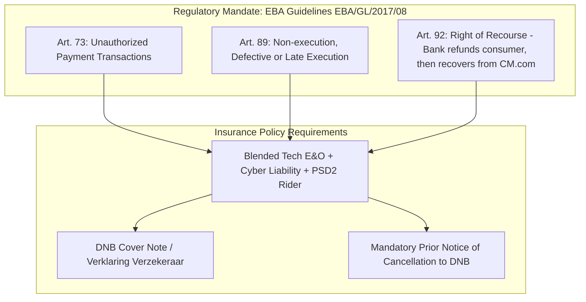
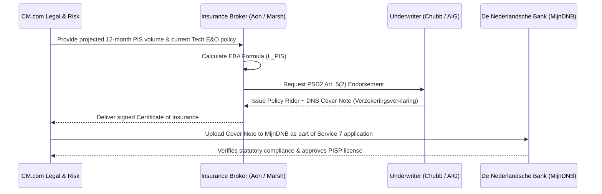

# PSD2 Professional Indemnity Insurance (PII) Analysis for CM.com
**Regulatory Reference:** PSD2 Article 5(2) & EBA Guidelines (EBA/GL/2017/08)  
**Supervisory Authority:** De Nederlandsche Bank (DNB)  
**Target Activity:** Payment Initiation Services (PISP - Service 7)  

---

## 1. How PSD2 Professional Indemnity Insurance Works

Under European law, when a Payment Initiation Service Provider (PISP) initiates a transaction from a consumer's bank account, it creates direct legal and financial liability toward both the **shopper (PSU)** and the **account-servicing bank (ASPSP)**:

### The Mandatory EBA Minimum Cover Formula ($L_{PIS}$)
The EBA prescribes an exact mathematical formula to calculate the minimum monetary insurance cover required:
$$L_{PIS} = \text{Risk Indicator} + \text{Volume Indicator} + \text{Size Indicator}$$
* **Volume Indicator:** Measured by the total projected gross value of payment transactions initiated by CM.com over a 12-month period.
* **Risk Indicator:** Based on internal authentication methods, anti-fraud algorithms, and error rates.
* **Resulting Policy Limit:** For an established payment volume, this formula generally mandates a minimum policy coverage of **€1,500,000 to €3,000,000 per claim** and **€3,000,000 to €5,000,000 in annual aggregate**.

---

## 2. Who Can Certify & Provide This Insurance?

Insurance in the Dutch regulated fintech market operates through a **Broker + Underwriter** model:

### A. The Specialized Brokers (*Assurantiemakelaars*)
These firms calculate the EBA formula, prepare the compliance filing, and structure the policy:
1. **Marsh Netherlands (FINPRO Practice):**
   * *Location:* Rotterdam & Amsterdam
   * *Specialty:* Market leader in financial institutions and PSD2 compliance insurance in the Netherlands. Directly interfaces with DNB compliance standards.
2. **Aon Netherlands (Financial Institutions & Fintech Specialty):**
   * *Location:* Rotterdam & Amsterdam
   * *Specialty:* Extensive experience handling DNB licensing filings for Dutch payment institutions and fintechs.
3. **WTW (Willis Towers Watson):**
   * *Specialty:* Global cyber, fintech liability, and regulatory compliance underwriting.
4. **Ecclesia Nederland:**
   * *Specialty:* Domestic Dutch mid-to-large corporate insurance advisor with dedicated professional liability teams.

### B. The Regulated Underwriters (*Risicodragers / Verzekeraars*)
These are the balance sheets that underwrite the risk and issue the binding **DNB Cover Note**:
* **Chubb European Group (Netherlands branch, Rotterdam/Amsterdam):** The dominant primary underwriter for Financial Institutions Professional Indemnity (FI-PI) in the Benelux market.
* **AIG Europe (Netherlands branch):** Major provider of blended Technology E&O + Cyber + PSD2 liability.
* **Beazley / Hiscox Europe:** Known for specialized tech-focused and cyber-integrated financial lines.
* **Lloyd's of London Syndicates:** Underwritten via Dutch Lloyd's coverholders for high-volume custom risks.

---

## 3. How Much Does It Cost?

The cost depends on whether CM.com adds an endorsement to its existing corporate insurance or purchases a standalone policy:

| Approach | Annual Premium Range | Typical Deductible (*Eigen Risico*) | Comments |
| :--- | :---: | :---: | :--- |
| **Option A: Rider / Endorsement to Existing Tech E&O Policy** *(Recommended)* | **€5,000 – €15,000 / year** | €10,000 – €25,000 | Leverage CM.com's existing corporate insurer (e.g., Chubb or AIG) to append the EBA PSD2 clause and issue the DNB certificate. Fastest and most cost-effective. |
| **Option B: Standalone Specialized Fintech PSD2 Policy** | **€15,000 – €35,000 / year** | €25,000 – €50,000 | A dedicated Financial Institutions Professional Indemnity (FI-PI) policy with independent limits specifically ring-fenced for CM Payments B.V. |

---

## 4. The 3-Step Execution Process for CM.com

1. **Step 1:** Have CM.com's Treasury/Risk manager pull the current corporate insurance schedule and contact the broker (Aon, Marsh, or current broker).
2. **Step 2:** Provide CM.com's projected year-1 Pay by Bank transaction volume so the broker can run the **EBA minimum cover calculation**.
3. **Step 3:** Request the formal **DNB-format Certificate of Insurance (*Verzekeringsverklaring voor betaalinstellingen*)** explicitly citing PSD2 Articles 73, 89, 90, and 92.
