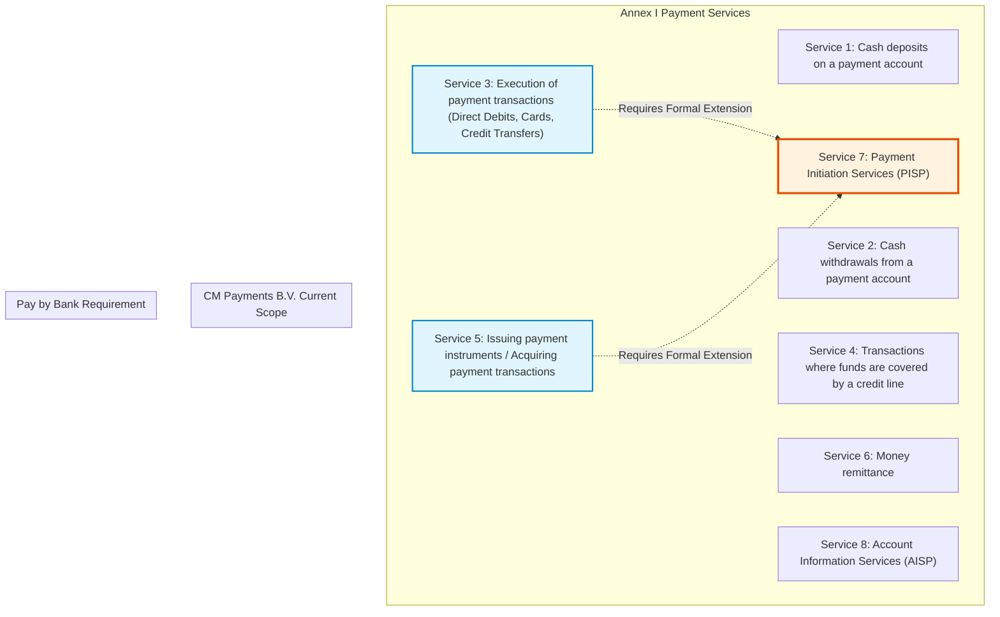
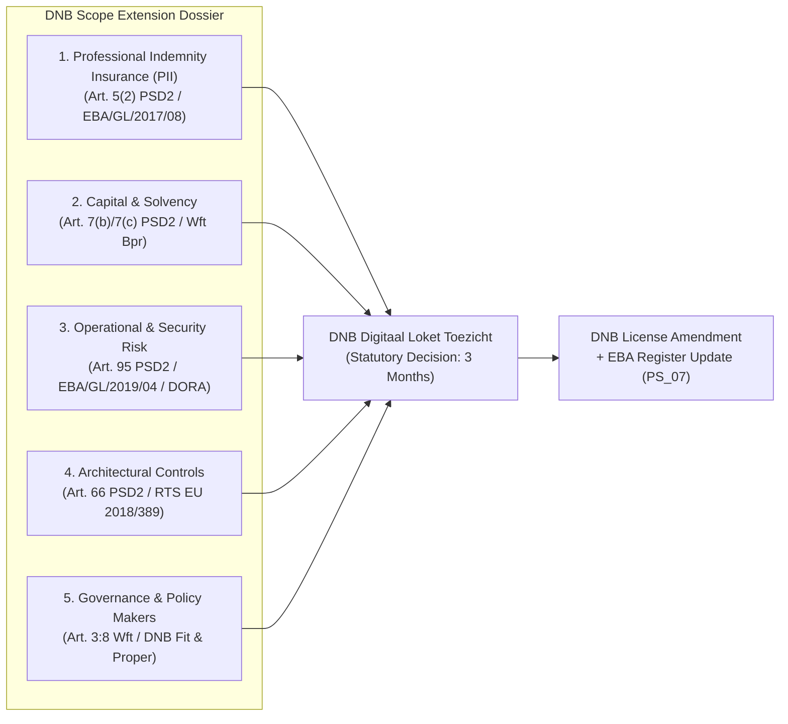
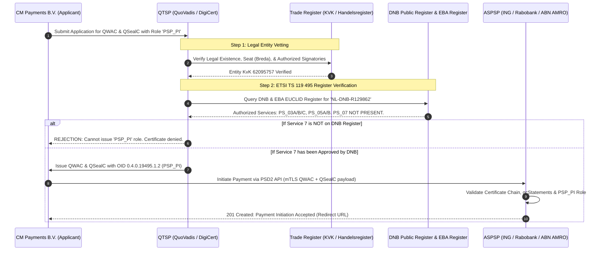

# PSD2 Regulatory Analysis: Payment Institution Licensing & PISP Authorization
**Document Title:** Legal & Regulatory Assessment of Payment Initiation Services (PISP) under PSD2 & Dutch Wft  
**Jurisdiction:** European Union (Directive (EU) 2015/2366) & The Netherlands (Wet op het financieel toezicht - Wft)  
**Supervisory Authority:** De Nederlandsche Bank (DNB) & European Banking Authority (EBA)  
**Target Subject:** CM Payments B.V. (Relation Number: R129862 / KvK: 62095757)  
**Date of Analysis:** November 2026  

---

## Executive Summary

This regulatory analysis evaluates the European and Dutch legal framework governing Payment Institution (PI) licensing under the revised Payment Services Directive (**PSD2 - Directive (EU) 2015/2366**) and the Dutch Financial Supervision Act (**Wet op het financieel toezicht - Wft**), specifically examining the regulatory standing of **CM Payments B.V.** (the regulated payments entity of **CM.com**) and the requirements to initiate account-to-account payments (**Pay by Bank**) as a licensed **Payment Initiation Service Provider (PISP)**.

### Core Findings:

1. **No Automatic Authorization:** A general Payment Institution (PI) or Electronic Money Institution (EMI) license does **not** automatically grant authorization to provide Payment Initiation Services (Annex I, Service 7). Authorization is strictly granular and activity-specific. Operating Service 7 without explicit DNB approval is an administrative violation and criminal offense under the Dutch Economic Offences Act (*Wet op de economische delicten - Wed*).
2. **Current Status of CM Payments B.V. (R129862):** CM Payments B.V. is currently authorized by DNB and registered in the EBA EUCLID Register exclusively for **Service 3** (execution of payment transactions: direct debits, card transactions, credit transfers) and **Service 5** (issuing of payment instruments and acquiring of payment transactions). **CM Payments B.V. does NOT hold authorization for Service 7 (PISP) or Service 8 (AISP).**
3. **Mandatory Scope Extension Application:** To initiate direct bank transfers (Pay by Bank) via Dutch and European bank Open Banking / XS2A APIs without relying on an external licensed intermediary, CM Payments B.V. must submit a formal **Application for Scope Extension (*Aanvraag tot uitbreiding van de vergunning*)** to DNB via the *Digitaal Loket Toezicht*.
4. **Mandatory PISP Prerequisites:** The primary hurdle is securing mandatory **Professional Indemnity Insurance (PII)** meeting the strict formula of **EBA Guidelines (EBA/GL/2017/08)** under PSD2 Article 5(2), accompanied by an explicit **DNB Cover Note (*Verzekeringsverklaring*)**, operational/security risk documentation under Article 95 PSD2 / DORA, and technical compliance with Article 66 (zero handling of customer funds, zero credential interception).
5. **eIDAS Certificate Gatekeeper:** Qualified Trust Service Providers (QTSPs) such as **QuoVadis** and **DigiCert** operate under **ETSI TS 119 495**. They conduct mandatory programmatic and manual checks against DNB's public register and the EBA register prior to issuing Qualified Website Authentication Certificates (QWAC) and Qualified Electronic Seal Certificates (QSealC). If Service 7 is absent from DNB's register, the QTSP is legally barred from encoding the `PSP_PI` role into the certificate. Without a `PSP_PI`-encoded certificate, ASPSPs (ING, Rabobank, ABN AMRO) automatically terminate API handshakes with HTTP 401/403 errors.

---

## 1. General PI / EMI License vs. Service 7 (PISP) Authorization

### 1.1 The Granular Licensing Architecture of PSD2
Under **Directive (EU) 2015/2366 (PSD2)**, the European legislator established an activity-based regulatory structure. Article 4(3) defines "payment services" as any business activity listed in **Annex I**. Annex I enumerates eight distinct payment services:

Under **Article 11(1) PSD2**, Member States require payment institutions intending to provide payment services to obtain an authorization. Critically, **an authorization is never granted in the abstract**. Article 5(1) mandates that the applicant must specify in its application the precise payment services from Annex I it intends to offer. The resulting license granted by the National Competent Authority (NCA) is strictly bounded by those specified activities.

### 1.2 Transposition into Dutch Law (Wft)
The Netherlands implemented PSD2 into the **Dutch Financial Supervision Act (*Wet op het financieel toezicht - Wft*)**:
* **Section 1:1 Wft:** Defines a *betaaldienst* by direct reference to the Annex of Directive (EU) 2015/2366.
* **Section 2:3a(1) Wft:** Establishes the statutory prohibition: *"It is prohibited for anyone with a registered office in the Netherlands to pursue the business of a payment institution without a license granted by De Nederlandsche Bank."*
* **Section 2:3b Wft:** Sets out the procedural requirements for obtaining authorization, establishing that DNB evaluates the applicant against the specific operational, financial, and risk criteria applicable to the requested services.

### 1.3 DNB Stance on Scope Extensions
De Nederlandsche Bank explicitly enforces that an institution authorized for certain payment services (e.g. Services 3 and 5) is legally barred from offering other services (such as Service 7) without prior regulatory approval.

According to DNB's official supervisory policy (*Open Boek Toezicht - Uitbreiding vergunning betaalinstelling*):
> *"Betaalinstellingen mogen uitsluitend betaaldiensten verrichten waarvoor zij expliciet een vergunning hebben verkregen. Als een bestaande instelling extra (additionele) betaaldiensten wil gaan aanbieden, is hiervoor een uitbreiding van de vergunning vereist."*  
> *(Payment institutions may only perform payment services for which they have explicitly obtained a license. If an existing institution wishes to offer additional payment services, an extension of the license is required.)*

Providing Service 7 without an explicit scope extension constitutes unauthorized financial services provisioning under Dutch law, exposing the institution and its directors to administrative enforcement (formal warnings, cease-and-desist orders, structural penalty payments under Section 1:79 Wft, administrative fines under Section 1:80 Wft) and criminal prosecution under the Economic Offences Act (*Wet op de economische delicten*).

---

## 2. Regulatory Status & Register Analysis: CM Payments B.V.

An empirical investigation of the official regulatory registers maintained by **De Nederlandsche Bank (DNB)** and the **European Banking Authority (EBA EUCLID Register)** was conducted for CM Payments B.V.

### 2.1 Corporate & Licensing Identifiers

| Parameter | Regulatory Record | Source |
| :--- | :--- | :--- |
| **Statutory Corporate Name** | CM Payments B.V. | DNB Public Register / Dutch Trade Register (KvK) |
| **Trade / Commercial Names** | CM Identity Services, docdata payments, CM.com, CM Payments B.V. | DNB / EBA Register |
| **DNB Relation Number** | **R129862** (DNBR129862) | DNB Openbaar Register |
| **EBA Entity Identifier** | `NL_DNB!R129862` | EBA Central EUCLID Register |
| **Legal Entity Identifier (LEI)** | `7245001NDFYKJ25EX569` | Global LEI Foundation (GLEIF) / DNB |
| **Chamber of Commerce (KvK)** | `62095757` | Handelsregister KVK |
| **Registered Seat** | Konijnenberg 24, 4825 BD Breda, The Netherlands | DNB Register Entry |
| **Entity Classification** | Betaalinstelling (Payment Institution - PSD_PI) | Art. 2:3b Wft / Directive 2015/2366 |
| **Authorization Date** | 19 February 2019 | DNB Register / EBA Register |
| **Supervised Group Entities** | *CM.com stichting* (registered escrow/third-party funds entity) | DNB Openbaar Register |

### 2.2 Granular Analysis of Authorized Payment Services
The EBA EUCLID register record (`NL_DNB!R129862`) for CM Payments B.V. specifies authorization for the following exact payment services in the Netherlands (NL) and passported across 30 European Economic Area (EEA) jurisdictions:

| Service Code | PSD2 Annex I Classification | Status for CM Payments B.V. | Legal Scope |
| :---: | :--- | :---: | :--- |
| **PS_01** | Service 1: Cash deposits on payment account | ❌ **NOT AUTHORIZED** | Operating cash deposit accounts |
| **PS_02** | Service 2: Cash withdrawals from payment account | ❌ **NOT AUTHORIZED** | Operating cash withdrawal accounts |
| **PS_03A** | Service 3(a): Execution of Direct Debits | ✅ **AUTHORIZED** | Processing one-off and recurring SEPA Direct Debits |
| **PS_03B** | Service 3(b): Execution of Card Payment Transactions | ✅ **AUTHORIZED** | Processing card transactions (Visa, Mastercard, etc.) |
| **PS_03C** | Service 3(c): Execution of Credit Transfers | ✅ **AUTHORIZED** | Executing SEPA credit transfers and standing orders |
| **PS_04** | Service 4: Transactions covered by credit line | ❌ **NOT AUTHORIZED** | Providing payment credit facilities |
| **PS_05A** | Service 5: Issuing of payment instruments | ✅ **AUTHORIZED** | Issuing payment instruments / tokens |
| **PS_05B** | Service 5: Acquiring of payment transactions | ✅ **AUTHORIZED** | Merchant acquiring (e-commerce gateway / POS) |
| **PS_06** | Service 6: Money Remittance | ❌ **NOT AUTHORIZED** | Cross-border remittance without account creation |
| **PS_07** | **Service 7: Payment Initiation Services (PISP)** | ❌ **NOT AUTHORIZED** | **Initiating payments from third-party bank accounts** |
| **PS_08** | **Service 8: Account Information Services (AISP)** | ❌ **NOT AUTHORIZED** | **Aggregating account balance and transaction data** |

### 2.3 Passporting Scope
CM Payments B.V. holds cross-border freedom of services (*vrijheid van dienstverlening*) notifications across all 30 EEA Member States (AT, BE, BG, CY, CZ, DE, DK, EE, ES, FI, FR, GR, HR, HU, IE, IS, IT, LI, LT, LU, LV, MT, NO, PL, PT, RO, SE, SI, SK). However, this passporting is **strictly limited to Services 3(a, b, c) and 5(a, b)**. 

### 2.4 Legal Implications for CM.com's "Pay by Bank"
Because CM Payments B.V. is authorized as an **Acquirer (Service 5b)** and **Credit Transfer Processor (Service 3c)**:
* CM Payments B.V. can act as a **Collecting Payment Service Provider (CPSP)** for merchant acquiring via standard schemes (e.g. iDEAL, Bancontact, EPS).
* Under the traditional **iDEAL** scheme, transactions are routed through Currence/EPI bank gateways where the consumer's bank handles the transaction as a direct bank transfer, and CM Payments acquires the resulting credit transfer as a CPSP.
* However, **CM Payments B.V. CANNOT initiate open banking API calls (Payment Initiation Services)** directly to ASPSPs (such as ING, Rabobank, ABN AMRO, Revolut) under the PSD2 XS2A regulatory regime.
* If CM.com provides or plans to provide a direct account-to-account "Pay by Bank" checkout button that communicates directly with European banks' PSD2 dedicated interfaces, it **must** either:
  1. Route the initiation through an authorized third-party PISP partner (e.g., Tink, Yapily, Token.io) acting as a technical distributor; OR
  2. **Obtain an explicit scope extension from DNB to add Service 7 (PISP) to its own license.**

---

## 3. Regulatory Prerequisites for Service 7 (PISP) Scope Extension

To expand its license to include Service 7, CM Payments B.V. must submit a comprehensive application to DNB via the *Digitaal Loket Toezicht*. DNB assesses the application against the prudential, operational, and conduct criteria established by PSD2 and the Wft.

### 3.1 Mandatory Professional Indemnity Insurance (PII)
Under **Article 5(2) of PSD2** and **Section 3:57 Wft**, holding an active Professional Indemnity Insurance (PII) policy or comparable guarantee is an absolute prerequisite for offering Service 7. Unlike other payment services where initial capital acts as the primary buffer, PISPs are legally mandated to maintain liability coverage to indemnify banks and consumers.

#### A. Regulatory Purpose & Covered Liabilities
The PII policy must provide direct financial protection against statutory liabilities under PSD2:
* **Article 73 PSD2:** Liability of the PISP for unauthorized payment transactions initiated through its service.
* **Article 89 PSD2:** Liability for non-execution, defective execution, or late execution of payment transactions.
* **Article 92 PSD2 (Right of Recourse):** If an ASPSP (bank) refunds a consumer for an unauthorized or defective transaction initiated by the PISP, the ASPSP has an immediate statutory right of financial recourse against the PISP.

#### B. Calculation Methodology (EBA Guidelines EBA/GL/2017/08)
The minimum monetary amount of insurance coverage cannot be arbitrary; it must be calculated using the mathematical formula mandated by the EBA:
$$\text{Minimum Cover} = \text{Risk Indicator} + \text{Volume Indicator} + \text{Size Indicator}$$

* **Volume Indicator:** Calculated from the projected gross total value of payment initiation transactions over a 12-month period.
* **Risk Indicator:** Evaluates internal authentication mechanisms, security controls, and fraud history.
* **Size Indicator:** Based on the gross fee and commission turnover generated by the PIS activity.
* **Resulting Coverage Limits:** For an established payment volume, this formula typically requires a minimum coverage limit of **€1,500,000 to €3,000,000 per claim** and **€3,000,000 to €5,000,000 annual aggregate**.

#### C. The DNB Cover Note (*Verzekeringsverklaring*)
DNB does not accept generic corporate liability certificates. The insurer or broker (e.g. Marsh, Aon, Chubb, AIG) must sign and deliver an official **DNB Insurance Declaration (*Verzekeringsverklaring voor betaalinstellingen*)** confirming:
1. The policy strictly complies with PSD2 Article 5(2) and EBA/GL/2017/08.
2. The insurer undertakes to notify DNB immediately (giving at least 30 days prior notice) if the policy is cancelled, modified, or lapses due to non-payment of premiums.

### 3.2 Capital Requirements (Initial Capital & Ongoing Own Funds)
The capital rules under PSD2 are differentiated by activity:
* **Initial Capital for Standalone PISP (Article 7(b) PSD2 / Section 48 Bpr):** A standalone PISP must hold minimum initial equity capital of **€50,000**.
* **Combined Payment Institution (Article 7(c) PSD2):** Because CM Payments B.V. already holds authorization for Services 3 and 5, it was already subject to the highest initial capital requirement of **€125,000**. Adding Service 7 does not trigger an incremental initial capital requirement beyond the €125,000 baseline.
* **Ongoing Solvency / Own Funds (*Toetsingsvermogen* - Article 8 PSD2 / Section 55 Bpr):** Standalone PISPs are exempt from ongoing own funds calculations (Methods A, B, and C) because they do not hold customer funds. However, because CM Payments B.V. is a combined institution providing acquiring and transaction execution, its ongoing own funds must continue to satisfy the relevant capital calculation (Method A, B, or C) covering its aggregate payment business.

### 3.3 Operational & Security Risk Management
Under **Article 95 PSD2**, **Section 3:17 Wft**, and the **EBA Guidelines on ICT and Security Risk Management (EBA/GL/2019/04)** (superseded/reinforced by the **Digital Operational Resilience Act - DORA, Regulation (EU) 2022/2554**):
1. **Security Risk Assessment:** Comprehensive documentation identifying operational risks specific to API-based payment initiation, including man-in-the-middle attacks, DNS hijacking, and certificate compromise.
2. **Incident Management & Reporting:** Documented procedures conforming to **EBA/GL/2021/03** for detecting and reporting major operational or security incidents to DNB within the strict statutory timeframes (initial notification within 4 hours; intermediate reports; final root-cause analysis within 1 month).
3. **Data Protection & GDPR:** Cryptographic security architecture ensuring end-to-end data confidentiality and auditability of transaction logs.
4. **Business Continuity & Disaster Recovery (BCP/DRP):** Documented recovery time objectives (RTO) and recovery point objectives (RPO) for high-availability checkout infrastructure.

### 3.4 PISP-Specific Architectural Safeguards
Under **Article 66(3) PSD2**, a PISP is subject to strict operational prohibitions and mandates:
* **Prohibition on Holding Funds (Art. 66(3)(a)):** The PISP must never hold the payer's funds at any stage of the transaction. The technical flow must ensure that funds transfer directly from the payer's account at the ASPSP to the payee's account (or the merchant's escrow).
* **Non-Storage of Sensitive Credentials (Art. 66(3)(e)):** The PISP is strictly prohibited from storing or processing personalized security credentials (e.g. online banking passwords, PINs, OTPs). All credential input must occur exclusively through bank-hosted redirect or decoupled authentication flows.
* **Explicit User Consent (Art. 66(3)(b)):** The PISP must capture and maintain unalterable cryptographic audit records of the payer's explicit consent to initiate each payment.
* **RTS Compliance (Delegated Regulation (EU) 2018/389):** Full compliance with Strong Customer Authentication (SCA) redirection mechanisms, secure hash communication, and mutual TLS over public networks.

### 3.5 Governance & Supervisory Vetting (*Geschiktheid en Betrouwbaarheid*)
Under **Sections 1:102 and 3:8 Wft**, DNB conducts suitability (*geschiktheid*) and integrity/propriety (*betrouwbaarheid*) testing of all day-to-day policymakers (*dagelijks beleidsbepalers*) and supervisory board members (*commissarissen*). If CM Payments B.V. creates a new dedicated business unit or appoints new executive directors or compliance officers to oversee the PISP service, those individuals must undergo formal vetting by DNB before assuming their duties.

### 3.6 Application Process, Tariffs & Timeline
* **Filing Channel:** Digital submission via DNB *Digitaal Loket Toezicht*.
* **Statutory Application Fee:** Governed by the *Regeling bekostiging financieel toezicht eenmalige handelingen*. Because CM Payments B.V. is already an authorized Payment Institution, the one-off application fee for a scope extension is **€2,700** (as opposed to €10,400 for a new institution application).
* **Statutory Review Window:** Under Section 2:3b Wft, DNB has a statutory period of **3 months** to decide upon receipt of a complete application dossier. If DNB issues requests for supplementary information (*vragenbrieven*), the legal decision clock is suspended (*opschortingstermijn*) until complete responses are furnished. Realistic industry approval timelines range between **4 and 7 months**.

---

## 4. How QTSPs Verify the DNB Register for eIDAS Certificates

Under PSD2 and the Regulatory Technical Standards on Strong Customer Authentication and Common and Secure Communication (**Commission Delegated Regulation (EU) 2018/389 - RTS on SCA/CSC**), communication between Third Party Providers (TPPs) and banks (ASPSPs) must be cryptographically secured using **eIDAS Qualified Certificates**.

### 4.1 Applicable Standards Framework
* **eIDAS Regulation (Regulation (EU) No 910/2014):** Governs Qualified Trust Service Providers (QTSPs) and legal validity of qualified certificates.
* **RTS on SCA/CSC, Article 34:** Mandates that for identification, payment service providers shall rely on:
  1. **Qualified Website Authentication Certificates (QWAC):** Used for transport-layer security (Mutual TLS) to secure communication between the TPP and the ASPSP.
  2. **Qualified Electronic Seal Certificates (QSealC):** Used at the application layer to digitally sign requests, payment orders, and consent tokens, ensuring non-repudiation.
* **ETSI TS 119 495:** The European Telecommunications Standards Institute technical specification establishing the precise certificate profiles, object identifiers (OIDs), and mandatory verification procedures that QTSPs must follow for PSD2 certificates.

### 4.2 Certificate Profile & Role Encoding (ETSI TS 119 495)
Under ETSI TS 119 495, PSD2 certificates contain a specialized extension called `qcStatements` with the specific statement `id-etsi-psd2-qcStatement` (OID `0.4.0.19495.2`). This statement incorporates:
1. **NCA Name & Identifier:**
   * `ncaName`: `"De Nederlandsche Bank"`
   * `ncaId`: `"NL-DNB"`
2. **PSP Authorization Number:**
   * Encoded as `"R129862"`
3. **Subject Distinguished Name (DN) Attribute:**
   * `organizationIdentifier` = `"PSDNL-DNB-R129862"`
4. **Authorized Roles (`rolesOfPSP`):** Encoded as distinct Object Identifiers:
   * `PSP_AS` (`0.4.0.19495.1.1`): Account Servicing (Banks)
   * `PSP_PI` (`0.4.0.19495.1.2`): **Payment Initiation Service Provider (PISP)**
   * `PSP_AI` (`0.4.0.19495.1.3`): Account Information Service Provider (AISP)
   * `PSP_IC` (`0.4.0.19495.1.4`): Issuing of Card-Based Payment Instruments

### 4.3 The 5-Stage Vetting Procedure by QTSPs (QuoVadis / DigiCert)
When an institution applies to a QTSP like QuoVadis (DigiCert Group) for a PSD2 certificate requesting the `PSP_PI` role, the QTSP executes the following statutory procedure:

#### Stage 1: Legal Entity Vetting
* The QTSP verifies that CM Payments B.V. is a legally registered company in good standing by pulling official extracts from the Dutch Chamber of Commerce (*Kamer van Koophandel - KvK 62095757*).
* The QTSP verifies the identity and representation authority of the certificate requester (via eIDAS-compliant video identification or notarized power of attorney).

#### Stage 2: Authoritative Register Verification (ETSI TS 119 495, Clause 6.2)
* The QTSP validation specialist (or automated registry connector) accesses the **official DNB Public Register (WFTBI / Openbaar Register)** and the **EBA EUCLID Register**.
* The QTSP cross-references the institution's official identifier (`R129862`) and Legal Entity Identifier (`7245001NDFYKJ25EX569`).

#### Stage 3: Granular Role Matching (The Critical Gate)
* **Under ETSI TS 119 495, Clause 6.2.2:** The QTSP is legally prohibited from relying on self-certification. The QTSP must verify that the NCA register explicitly authorizes the institution for the requested role:
  * To encode `PSP_PI` (OID `0.4.0.19495.1.2`), the NCA register **MUST explicitly list Service 7**.
  * If the register shows only Services 3 and 5 (as is currently the case for CM Payments B.V.), the QTSP **cannot legally issue a certificate containing the `PSP_PI` role**.
  * If an applicant insists on a PSD2 certificate without Service 7 authorization, the QTSP can only issue a certificate reflecting their actual authorized roles (e.g. `PSP_IC`) or must reject the application entirely.

#### Stage 4: Certificate Generation & Cryptographic Binding
* Once Service 7 authorization is confirmed on DNB's register, the QTSP generates the certificate, immutably binding the `organizationIdentifier` (`PSDNL-DNB-R129862`) and the `PSP_PI` OID into the signed X.509 certificate structure.

#### Stage 5: Continuous Monitoring & Revocation Obligations
* Under ETSI TS 119 495 Clause 6.2.4 and RTS Article 34, if DNB revokes or suspends a payment institution's license, or removes Service 7 from its scope, DNB or the PSP is required to notify the QTSP.
* Upon notification or discovery through periodic register polling, the QTSP is legally obligated to **revoke the certificate within 24 hours**.

### 4.4 ASPSP (Bank) Enforcement at Runtime
When a PISP calls an ASPSP's API endpoint (e.g. `POST /v1/payments/sepa-credit-transfers` at ING, Rabobank, or ABN AMRO):
1. **mTLS Handshake:** The bank's API gateway terminates TLS and validates the client's QWAC against official European Trusted Lists (EUTL).
2. **qcStatements Parsing:** The bank extracts the `rolesOfPSP` extension. If the certificate lacks the `PSP_PI` OID (`0.4.0.19495.1.2`), the API gateway immediately rejects the connection with an **HTTP 401 Unauthorized** or **HTTP 403 Forbidden (`ROLE_INVALID`)**.
3. **Payload Signature Verification:** The bank verifies the HTTP request signature generated by the client's QSealC.
4. **Real-Time Register Cross-Check:** High-tier Dutch banks maintain automated connections to the EBA register or commercial Open Banking directories (e.g., Open Banking Europe / PRETA, Konsentus) to perform real-time verification that the authorization status of `NL-DNB-R129862` remains active.

---

## 5. Comparative Strategic Roadmap for CM.com

Given that CM Payments B.V. currently lacks Service 7 authorization, CM.com has two structural pathways to deliver "Pay by Bank" functionality:

```mermaid
flowchart TD
    subgraph Option A: Third-Party PISP Aggregator
        A1["Merchant Checkout"] --> A2["CM.com Gateway / UI"]
        A2 -->|API Proxy| A3["Licensed PISP Partner<br>(Tink / Yapily / Token.io)"]
        A3 -->|eIDAS PSP_PI| A4["Dutch & European Banks<br>(ING, Rabobank, ABN AMRO)"]
    end

    subgraph Option B: Proprietary DNB Scope Extension
        B1["Merchant Checkout"] --> B2["CM.com Gateway / UI"]
        B2 -->|Direct Core Banking Integration| B3["CM Payments B.V.<br>(DNB Service 7 Licensed)"]
        B3 -->|Proprietary eIDAS PSP_PI| B4["Dutch & European Banks<br>(ING, Rabobank, ABN AMRO)"]
    end

    style Option A fill:#f1f8e9,stroke:#558b2f,stroke-width:2px
    style Option B fill:#ede7f6,stroke:#512da8,stroke-width:2px
```

| Dimension | Option A: Partner PISP Integration (Technical Service Provider - Art. 3(j)) | Option B: Proprietary DNB Scope Extension (Direct Service 7 License) |
| :--- | :--- | :--- |
| **Legal Role of CM.com** | Technical Service Provider (TSP) / Commercial Reseller | Direct Authorized Payment Initiation Service Provider (PISP) |
| **DNB Licensing Scope** | No change required (operates under current Services 3 & 5) | Formal Scope Extension Application (*Uitbreiding vergunning*) |
| **Upfront DNB Costs** | €0 | €2,700 statutory application fee + internal regulatory filing costs |
| **Annual Regulatory Overhead** | €0 | €15,000 – €35,000 / year (standalone PII policy; €5,000 – €15,000 as a rider on existing tech E&O) + €2,000 eIDAS certs + DNB variable levy |
| **Time to Market** | Immediate (4 – 8 weeks integration) | 4 – 7 months (statutory review + policy issuance) |
| **eIDAS Certificate Ownership** | Partner holds QWAC/QSealC with `PSP_PI` | CM Payments B.V. holds proprietary QWAC/QSealC (`PSDNL-DNB-R129862`) |
| **User Experience & Branding** | Bank redirect shows partner's legal name (or co-branding) | Bank redirect shows **CM Payments B.V.** directly |
| **Unit Economics at Scale** | Aggregator fee per transaction (~€0.05 – €0.15 / txn) | Pure flat internal infrastructure cost; maximum margin retention |
| **Strategic Autonomy** | Dependent on third-party vendor uptime, roadmap, and pricing | 100% independent payments rail; complete control over bank API connections |

---

## 6. Conclusion & Recommendations

1. **Definitive Regulatory Answer:** CM Payments B.V. is **not authorized** to initiate payments under PSD2. A general Payment Institution license does not extend to Payment Initiation Services without an explicit regulatory grant from DNB.
2. **Immediate Action Item for Direct Pay by Bank:** If CM.com intends to connect directly to the APIs of Dutch banks (ING, Rabobank, ABN AMRO, etc.) using its own cryptographic identity:
   * **Initiate Scope Extension:** Formulate and file a Scope Extension Application (*Aanvraag tot uitbreiding van de vergunning*) for Service 7 with DNB via the *Digitaal Loket Toezicht*.
   * **Procure Mandatory PII:** Engage insurance brokers (Aon or Marsh) immediately to calculate the EBA minimum cover amount ($L_{PIS}$) and secure the binding **DNB Insurance Declaration (*Verzekeringsverklaring*)**.
   * **Align Technical Architecture:** Ensure all technical workflows strictly conform to Article 66 PSD2 (zero handling of payer funds, zero interception/storage of credentials, robust SCA redirect flows).
3. **Interim Strategy:** During the 4 to 7 month regulatory review period, CM.com can launch Pay by Bank commercially by routing API calls through an authorized third-party PISP aggregator, seamlessly transitioning traffic to its own licensed PISP rail once DNB publishes the Service 7 update to the national and EBA registers.
