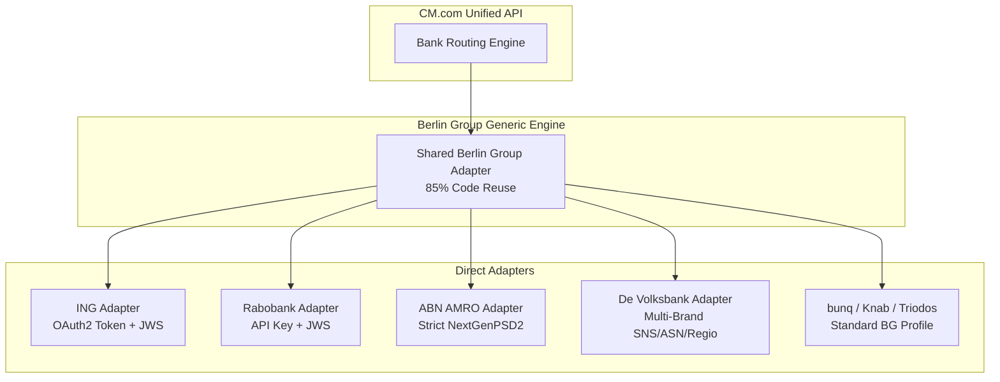
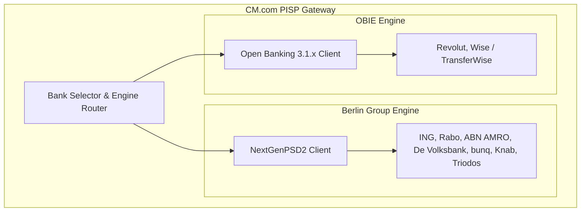

# Comprehensive Analysis: Top 10 Dutch Banks & API Endpoints for Pay by Bank
**Target System:** CM.com Direct Payment Initiation Service (PISP) Engine  
**Jurisdiction:** Netherlands (DNB regulated)  
**Standard:** PSD2 XS2A (primarily Berlin Group NextGenPSD2 Framework)  

---

## 1. Executive Summary & Market Landscape

In the Netherlands, the banking sector is divided into **Universal/Retail Commercial Banks** (which hold consumer current accounts relevant to Pay by Bank) and **Specialized Public-Sector Financing Agencies** (which hold massive balance-sheet assets but no consumer payment accounts).

* **The Big 3 (ING, Rabobank, ABN AMRO)** control **~80%–85%** of all Dutch retail payment accounts.
* **De Volksbank (SNS, ASN, RegioBank)** captures another **~10%**.
* **Digital Challengers & Specialists (bunq, Knab, Triodos, Van Lanschot)** represent the remaining **~5%–7%**.
* **Public Institutions (BNG, NWB)** hold ~€180B in assets but **do not offer consumer retail Payment Initiation Services (PIS)**.

Connecting to the **top 6 consumer banking groups** gives CM.com **>98% coverage** of all bank accounts in the Netherlands.

---

## 2. Comparative Matrix: Top 10 Banks in the Netherlands

| Rank | Bank Institution | Total Assets | Retail PIS Relevance | Open Banking Standard | Developer Portal / API Host |
| :---: | :--- | :--- | :---: | :--- | :--- |
| **1** | **ING Bank** | ~€1,050B | **Critical (35%+)** | Berlin Group NextGenPSD2 | [developer.ing.com](https://developer.ing.com)<br>`api.ing.com` |
| **2** | **Rabobank** | ~€630B | **Critical (30%+)** | Berlin Group NextGenPSD2 | [developer.rabobank.nl](https://docs.developer.rabobank.com)<br>`api.rabobank.nl` |
| **3** | **ABN AMRO** | ~€380B | **Critical (20%)** | Berlin Group NextGenPSD2 | [developer.abnamro.com](https://developer.abnamro.com)<br>`api.abnamro.com` |
| **4** | **BNG Bank** | ~€110B | *None (Public/Institutional only)* | N/A (No consumer current accounts) | Institutional Treasury Portals |
| **5** | **NWB Bank** | ~€75B | *None (Water boards/Public sector)* | N/A (No consumer current accounts) | Institutional Treasury Portals |
| **6** | **de Volksbank**<br>*(SNS, ASN, RegioBank)* | ~€70B | **High (8-10%)** | Berlin Group NextGenPSD2 | [openbanking.devolksbank.nl](https://openbanking.devolksbank.nl)<br>`api.openbanking.devolksbank.nl` |
| **7** | **NN Bank** (Nationale-Nederlanden) | ~€25B | *Low (Savings & Mortgages only)* | Limited (Primarily savings AIS) | [nn.nl / openbanking](https://www.nn.nl) |
| **8** | **Van Lanschot Kempen** | ~€16B | **Moderate (Private Wealth)** | Berlin Group NextGenPSD2 | [openbanking.vanlanschotkempen.com](https://openbanking.vanlanschotkempen.com) |
| **9** | **Triodos Bank** | ~€16B | **Moderate (Ethical Retail)** | Berlin Group NextGenPSD2 | [openbanking.triodos.com](https://openbanking.triodos.com)<br>`api.openbanking.triodos.com` |
| **10a** | **Knab** *(BAWAG Group)* | ~€18B | **High (Freelancers / ZZP)** | Berlin Group NextGenPSD2 | [developer.knab.nl](https://developer.knab.nl)<br>`api.knab.nl` |
| **10b** | **bunq** | ~€5B | **High (Digital Native/Mobile)** | Berlin Group + Proprietary REST API | [developer.bunq.com](https://developer.bunq.com)<br>`api.bunq.com` |

---

## 3. Deep-Dive: Retail Banking Endpoints & Integration Patterns

### 1. ING Bank (ING Groep N.V.)
* **Endpoint Pattern:**
  * Initiate Payment: `POST https://api.ing.com/v1/payments/sepa-credit-transfers`
  * Check Status: `GET https://api.ing.com/v1/payments/sepa-credit-transfers/{paymentId}/status`
  * Authorisation/SCA: `POST https://api.ing.com/v1/payments/sepa-credit-transfers/{paymentId}/authorisations`
* **Auth Protocol:** 2-step flow:
  1. `POST https://api.ing.com/oauth2/token` (mTLS with eIDAS QWAC) to obtain an application bearer token.
  2. Call payment endpoint with `Authorization: Bearer <token>`, payload signed with `QSealC` (`Digest` + `Signature` headers).
* **SCA & Redirection:** Supports Redirect & Decoupled mode. In mobile checkout, opens **ING Mobiel Bankieren** via Universal Links (`https://www.ing.nl/app/...`).

---

### 2. Rabobank (Coöperatieve Rabobank U.A.)
* **Endpoint Pattern:**
  * Initiate Payment: `POST https://api.rabobank.nl/openapi/sandbox/payments/sepa-credit-transfers` (Sandbox) / `https://api.rabobank.nl/openapi/payments/sepa-credit-transfers` (Prod)
  * Check Status: `GET https://api.rabobank.nl/openapi/payments/sepa-credit-transfers/{paymentId}/status`
* **Auth Protocol:**
  * mTLS with QWAC.
  * API Key (`X-IBM-Client-Id` or developer token) issued via Rabobank Developer Portal.
  * Payload signing with QSealC certificate.
* **SCA & Redirection:** Redirect approach. Seamless transition to **Rabo App** (App-to-App) on mobile devices or Rabo Scanner color QR code for desktop browsers.

---

### 3. ABN AMRO Bank N.V.
* **Endpoint Pattern:**
  * Initiate Payment: `POST https://api.abnamro.com/v1/payments/sepa-credit-transfers`
  * Check Status: `GET https://api.abnamro.com/v1/payments/sepa-credit-transfers/{paymentId}/status`
* **Auth Protocol:**
  * Strict Berlin Group NextGenPSD2 conformance.
  * mTLS mutual authentication with QWAC.
  * HTTP Signature with QSealC for non-repudiation.
* **SCA & Redirection:** App-to-App deep link to **ABN AMRO Mobiel Bankieren** or e.dentifier QR code on web.

---

### 4. de Volksbank (SNS Bank, ASN Bank, RegioBank)
* **Single Gateway Architecture:** One centralized backend services all three customer brands.
* **Endpoint Pattern:**
  * Initiate Payment: `POST https://api.openbanking.devolksbank.nl/v1/payments/sepa-credit-transfers`
  * Check Status: `GET https://api.openbanking.devolksbank.nl/v1/payments/sepa-credit-transfers/{paymentId}/status`
* **Brand Routing:** The consumer selects whether they use SNS, ASN Bank, or RegioBank. The debtor BIC determines brand styling and redirection.
* **SCA & Redirection:** Redirect to respective brand web portal or native mobile app (SNS Mobiel Bankieren or ASN Bankieren).

---

### 5. bunq B.V.
* **Dual API Support:** bunq offers both a standardized Berlin Group XS2A gateway for regulatory compliance AND a best-in-class direct REST JSON API.
* **Standard PSD2 Endpoint:**
  * `POST https://api.bunq.com/v1/payments/sepa-credit-transfers` (Berlin Group format)
* **Proprietary Direct API (`api.bunq.com`):**
  * Allows creating direct Payment Requests / QR codes with real-time webhooks over WebSocket or webhook callbacks.
  * Native App-to-App deep links directly into the bunq app.

---

### 6. Knab (BAWAG Group)
* **Target Audience:** Freelancers (ZZP), small businesses, and digital-first retail users.
* **Endpoint Pattern:**
  * Initiate Payment: `POST https://api.knab.nl/v1/payments/sepa-credit-transfers`
  * Check Status: `GET https://api.knab.nl/v1/payments/sepa-credit-transfers/{paymentId}/status`
* **Standard:** Berlin Group NextGenPSD2.
* **SCA & Redirection:** Knab App biometric authorization.

---

### 7. Triodos Bank N.V.
* **Endpoint Pattern:**
  * Initiate Payment: `POST https://api.openbanking.triodos.com/v1/payments/sepa-credit-transfers`
  * Status: `GET https://api.openbanking.triodos.com/v1/payments/sepa-credit-transfers/{paymentId}/status`
* **Standard:** Berlin Group NextGenPSD2 via openbanking.triodos.com.
* **SCA:** Triodos Mobile Banking App.

---

## 4. Key Architectural Insights for CM.com



1. **85%+ Code Reusability:** Because all Dutch retail banks standardized on **Berlin Group NextGenPSD2**, CM.com only needs to write **one core Berlin Group payment client**.
2. **Bank-Specific Dialects:** The only variations to manage are:
   * **ING:** Token pre-exchange (`/oauth2/token`).
   * **Rabobank:** Client IDs and specific custom header formats.
   * **De Volksbank:** Multi-brand dispatching across ASN, SNS, and RegioBank.
   * **bunq:** Strict instant settlement feedback.
3. **High Return on Effort:** Connecting just **ING, Rabobank, ABN AMRO, and De Volksbank** captures **>95% of Dutch consumer checkouts** with only 4 adapter configurations.

---

## 5. Pan-European Fintech Challengers: Revolut & Wise (TransferWise)

Both **Revolut** and **Wise** have massive, fast-growing footprints among Dutch consumers and international shoppers in the Netherlands. Revolut now issues native Dutch IBANs (`NL..REVO...`) through its Dutch branch.

### Architectural Pivot: The OBIE Standard vs. Berlin Group
Unlike the domestic Dutch retail banks that use Berlin Group NextGenPSD2, **both Revolut and Wise adopted the Open Banking UK / OBIE (v3.1.x) standard** for their open banking gateways across Europe.



---

### A. Revolut (Revolut Bank UAB - Dutch Branch)

* **Developer Portal:** [Revolut Open Banking Portal](https://developer.revolut.com/docs/open-banking)
* **Base URLs:**
  * **Production:** `https://oba.revolut.com`
  * **Sandbox:** `https://sandbox-oba.revolut.com`
  * **Auth Host:** `https://oba-auth.revolut.com`
* **Protocol & Standards:** Open Banking (OBIE standard with SEPA extensions).
* **Two-Step Payment Initiation Flow:**
  1. **Token Acquisition:**
     ```http
     POST https://oba-auth.revolut.com/token
     Content-Type: application/x-www-form-urlencoded
     grant_type=client_credentials&scope=payments
     ```
     *(Requires mTLS client authentication with eIDAS QWAC)*
  2. **Payment Consent Creation:**
     ```http
     POST https://oba.revolut.com/domestic-payment-consents
     Authorization: Bearer <token>
     x-fapi-financial-id: <revolut-financial-id>
     x-idempotency-key: <uuid>
     
     {
       "Data": {
         "Initiation": {
           "InstructionIdentification": "CM-ORD-88192",
           "EndToEndIdentification": "CM-PAY-4410",
           "InstructedAmount": { "Amount": "59.00", "Currency": "EUR" },
           "CreditorAccount": { "SchemeName": "IBAN", "Identification": "NL99CMCO0123456789", "Name": "CM Payments B.V." }
         }
       }
     }
     ```
  3. **Consumer SCA:** Redirect shopper via Universal Link (`https://revolut.me/...` or Revolut App deep link). Shopper approves via Face ID.
  4. **Payment Submission:**
     ```http
     POST https://oba.revolut.com/domestic-payments
     ```
* **Settlement:** Instant SEPA Credit Transfer (SCT Inst) via Revolut Bank UAB.

---

### B. Wise (Formerly TransferWise - Wise Europe SA)

* **Developer Portal:** [Wise Open Banking Documentation](https://wise.com/help/articles/2978044)
* **Base URLs:**
  * **Production:** `https://openbanking.transferwise.com`
  * **Sandbox:** `https://openbanking.wise-sandbox.com`
* **Protocol & Standards:** Open Banking UK (v3.1.11+) adapted for EEA SEPA rails.
* **Authentication:** Mutual TLS (mTLS) with eIDAS QWAC certificate.
* **Payment Flow:**
  1. `POST /open-banking/v3.1/pisp/domestic-payment-consents` to create the payment intent.
  2. Redirect consumer to Wise authentication portal / Wise mobile app.
  3. Consumer confirms biometric SCA in the Wise App.
  4. CM.com calls `POST /open-banking/v3.1/pisp/domestic-payments` with the authorized `ConsentId` to trigger the SEPA transfer.
  5. Check status via `GET /open-banking/v3.1/pisp/domestic-payments/{PaymentId}`.

---

## 6. Summary of Engineering Engines for CM.com

To achieve 100% full-spectrum coverage of the Netherlands:

1. **Engine 1: Berlin Group NextGenPSD2 Engine (90% of Dutch traffic):**
   * Covers: ING, Rabobank, ABN AMRO, De Volksbank (SNS, ASN, Regio), bunq, Knab, Triodos, Van Lanschot.
   * Path: `POST /v1/payments/sepa-credit-transfers`
2. **Engine 2: OBIE / Open Banking Read-Write Engine (10% of traffic, cross-border & expats):**
   * Covers: Revolut, Wise (TransferWise).
   * Path: `POST /domestic-payment-consents` followed by `POST /domestic-payments`.
